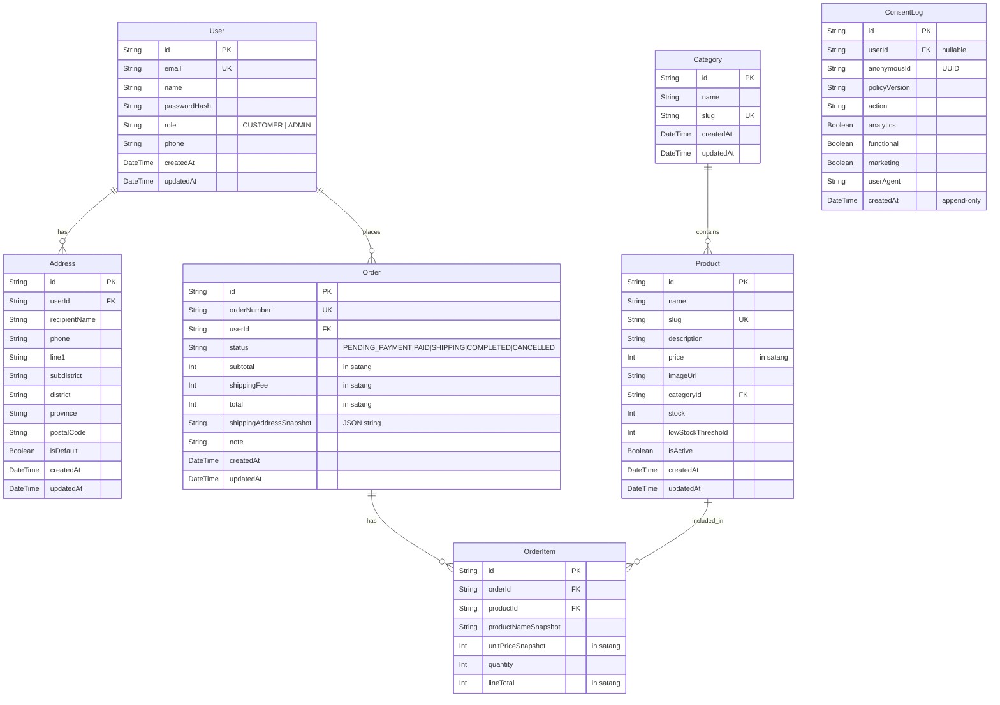

# Database Schema

แผนภาพ Entity-Relationship (ER Diagram) ของระบบ AquaVita

## รายละเอียดตาราง

- **User**: เก็บข้อมูลผู้ใช้และผู้ดูแลระบบ
- **Category**: หมวดหมู่สินค้า
- **Product**: สินค้า (ใช้สตางค์สำหรับราคากัน float issues, ใช้ isActive สำหรับ soft delete)
- **Address**: ที่อยู่จัดส่งของผู้ใช้ (ผู้ใช้ 1 คนมีหลายที่อยู่ได้)
- **Order**: คำสั่งซื้อ (เก็บ snapshot ที่อยู่เพื่อไม่ให้ประวัติเปลี่ยน)
- **OrderItem**: รายการสินค้าในแต่ละคำสั่งซื้อ (เก็บ snapshot ชื่อและราคา)
- **ConsentLog**: บันทึกความยินยอมคุกกี้ (PDPA) เป็นแบบ Append-only ไม่มีการลบ
